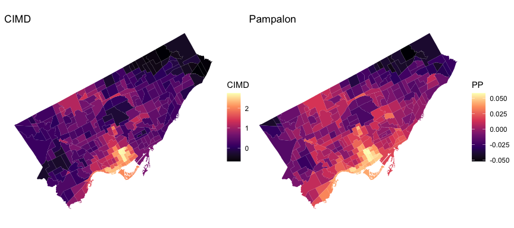
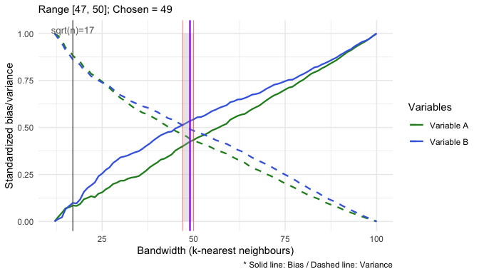
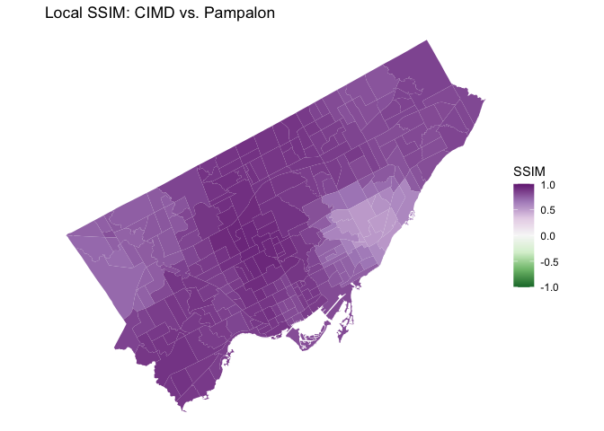
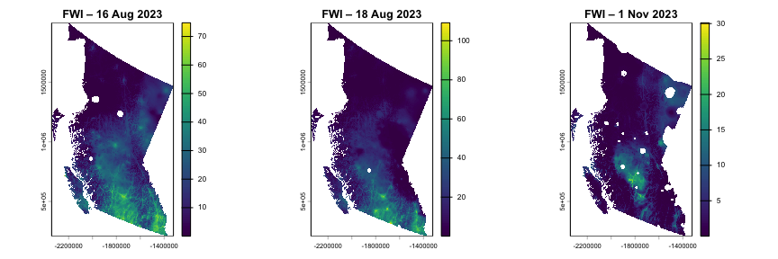

<!-- README.md is generated from README.Rmd. Please edit that file -->

# SSIMmap 

<!-- badges: start -->

[](https://CRAN.R-project.org/package=SSIMmap)
[](https://CRAN.R-project.org/package=SSIMmap)
[](https://opensource.org/licenses/MIT)
<!-- badges: end -->

The goal of **SSIMmap** is to extend the classical [Structural
Similarity Index Measure
(SSIM)](https://ieeexplore.ieee.org/document/1284395) — originally
developed for image quality assessment — to **maps**. The package
provides a unified framework for quantifying spatial similarity between
two maps of the same area, for both **irregular polygon (lattice) data**
and **raster images**.

For polygon maps, the geographical SSIM method incorporates
[geographically weighted summary
statistics](https://www.sciencedirect.com/science/article/pii/S0198971501000096)
with an adaptive *k*-nearest-neighbour Gaussian kernel. For raster
images, SSIM is computed using a moving window. In addition to point
estimates, SSIMmap also supports **permutation tests** for both global
and local significance, with optional Benjamini–Hochberg FDR correction.

## Key features

- **`ssim_bandwidth()`** — bias–variance trade-off plots to help choose
  an appropriate bandwidth (number of neighbours *k*) for polygon maps.
- **`ssim_polygon()`** — global and local SSIM (and components SIM, SIV,
  SIP) for polygon maps, with permutation testing and FDR correction.
- **`ssim_raster()`** — global and local SSIM for raster images, with
  permutation testing and per-cell p-/q-values.
- Multiple **value transforms** (`"normal_score"`, `"percentile"`,
  `"minmax"`, `"none"`) for comparing variables on different scales.
- Built-in example data: Toronto Census Tract deprivation indices
  (`Toronto_SSIM`) and British Columbia Fire Weather Index rasters
  (`fwi_0816_bc`, `fwi_0818_bc`, `fwi_1101_bc`).

## Installation

Install the released version from CRAN:

``` r
install.packages("SSIMmap")
```

Or the development version from GitHub:

``` r
# install.packages("remotes")
remotes::install_github("Hailyee-Ha/SSIMmap", build_vignettes = TRUE)
```

## Quick example

``` r
library(SSIMmap)
library(sf)
library(terra)
library(ggplot2)
library(patchwork)
library(tidyterra)
```

### Example 1 — Polygon maps: comparing two deprivation indices in Toronto

The package ships with `Toronto_SSIM`, an `sf` object covering Toronto
Census Tracts. It includes two area-based deprivation indices (the
**Canadian Index of Multiple Deprivation**, `CIMD`, and the **Pampalon**
index, `PP`) and a 2016 census variable (`Commute`).

``` r
data("Toronto_SSIM")

p_cimd <- ggplot(Toronto_SSIM) +
  geom_sf(aes(fill = CIMD), color = NA) +
  scale_fill_viridis_c(option = "magma") +
  labs(title = "CIMD") + theme_void()

p_pp <- ggplot(Toronto_SSIM) +
  geom_sf(aes(fill = PP), color = NA) +
  scale_fill_viridis_c(option = "magma") +
  labs(title = "Pampalon") + theme_void()

p_cimd + p_pp
```



#### Step 1: Choose a bandwidth

`ssim_bandwidth()` provides a bias–variance trade-off curve for
selecting *k*, the number of nearest neighbours used in the adaptive
kernel.

``` r
S <- ssim_bandwidth(
  shape         = Toronto_SSIM,
  map1          = "CIMD",
  map2          = "PP",
  max_bandwidth = 100,
  transform     = "percentile",
  option        = "midpoint"
)
S$bandwidth
#> [1] 49
S$plot
```



#### Step 2: Compute global SSIM with a permutation test

``` r
S_global <- ssim_polygon(
  shape     = Toronto_SSIM,
  map1      = "CIMD",
  map2      = "PP",
  global    = TRUE,
  bandwidth = S$bandwidth,
  transform = "percentile",
  do_test   = TRUE, R = 1000, fdr = TRUE, alpha = 0.05,
  seed      = 1
)
#> 
#> 
#> |Statistic |      SSIM|       SIM|       SIV|       SIP|
#> |:---------|---------:|---------:|---------:|---------:|
#> |Mean      | 0.8250472| 0.9921019| 0.9912113| 0.8392269|
#> |Min       | 0.5103267| 0.9505378| 0.9470631| 0.5118904|
#> |Max       | 0.9519651| 1.0000000| 0.9999999| 0.9520484|
#> |SD        | 0.0931275| 0.0107547| 0.0109567| 0.0953972|
#> 
#> Global permutation p-values (two-sided):
#> 
#> 
#> |Component | Global_Mean| P_value|
#> |:---------|-----------:|-------:|
#> |SSIM      |      0.8250|  0.0010|
#> |SIM       |      0.9921|  0.3397|
#> |SIV       |      0.9912|  0.0090|
#> |SIP       |      0.8392|  0.0010|
S_global$p_global
#>   Component Global_Mean     P_value
#> 1      SSIM   0.8250472 0.000999001
#> 2       SIM   0.9921019 0.339660340
#> 3       SIV   0.9912113 0.008991009
#> 4       SIP   0.8392269 0.000999001
```

#### Step 3: Compute local SSIM and visualize it

``` r
S_local <- ssim_polygon(
  shape     = Toronto_SSIM,
  map1      = "CIMD",
  map2      = "PP",
  global    = FALSE,
  bandwidth = S$bandwidth,
  transform = "percentile",
  do_test   = TRUE, R = 1000, fdr = TRUE, alpha = 0.05,
  seed      = 1
)

ggplot(S_local) +
  geom_sf(aes(fill = SSIM), color = NA) +
  scale_fill_distiller(palette = "PRGn", limits = c(-1, 1)) +
  labs(title = "Local SSIM: CIMD vs. Pampalon") +
  theme_void()
```



The `S_local` object is an ordinary `sf` data frame, so you can also map
components (`SIM`, `SIV`, `SIP`) or the FDR-significant cells (`sig`)
using your favourite mapping package (`ggplot2`, `tmap`, etc.).

### Example 2 — Raster maps: comparing daily Fire Weather Index in British Columbia

The package also includes three daily **Canadian Fire Weather Index
(FWI)** maps for British Columbia at a 2 km resolution. Two represent
the peak summer fire season (16 and 18 August 2023) and one represents
late fall (1 November 2023). We expect the two summer maps to be much
more similar to each other than either one is to the fall map.

``` r
data("fwi_0816_bc"); fwi_0816_bc <- terra::unwrap(fwi_0816_bc)
data("fwi_0818_bc"); fwi_0818_bc <- terra::unwrap(fwi_0818_bc)
data("fwi_1101_bc"); fwi_1101_bc <- terra::unwrap(fwi_1101_bc)

par(mfrow = c(1, 3))
plot(fwi_0816_bc, main = "FWI – 16 Aug 2023")
plot(fwi_0818_bc, main = "FWI – 18 Aug 2023")
plot(fwi_1101_bc, main = "FWI – 1 Nov 2023")
```



#### Global SSIM

A quick global comparison (no permutation test, fast):

``` r
ssim_raster(fwi_0816_bc, fwi_0818_bc)   # summer vs summer
#> $summary
#>   metric      mean         min       max         sd
#> 1   SSIM 0.5380046 -0.98968521 0.9999790 0.58855978
#> 2    SIM 0.5507247 -0.99427575 1.0000000 0.60271292
#> 3    SIV 0.9822690  0.40999905 1.0000000 0.03216969
#> 4    SIP 0.9924066  0.03063862 0.9999998 0.02029212
#> 
#> $settings
#> $settings$global
#> [1] TRUE
#> 
#> $settings$w
#> [1] 1
#> 
#> $settings$transform
#> [1] "normal_score"
#> 
#> $settings$do_test
#> [1] FALSE
#> 
#> $settings$local_test
#> [1] FALSE
ssim_raster(fwi_0816_bc, fwi_1101_bc)   # summer vs fall
#> $summary
#>   metric      mean        min       max         sd
#> 1   SSIM 0.2909122 -0.9914894 0.9998444 0.61660743
#> 2    SIM 0.3063775 -0.9964454 1.0000000 0.65287253
#> 3    SIV 0.9561909  0.2553303 1.0000000 0.06145141
#> 4    SIP 0.9845342 -0.1710329 0.9999987 0.04173728
#> 
#> $settings
#> $settings$global
#> [1] TRUE
#> 
#> $settings$w
#> [1] 1
#> 
#> $settings$transform
#> [1] "normal_score"
#> 
#> $settings$do_test
#> [1] FALSE
#> 
#> $settings$local_test
#> [1] FALSE
```

As expected, the summer–summer comparison shows much higher similarity
than the summer–fall comparison.

#### Local SSIM and components

For per-cell SSIM surfaces, set `global = FALSE`. Below we use
`tidyterra` to faceted-plot the four SSIM components:

``` r
p1_l <- ssim_raster(
  fwi_0816_bc, fwi_0818_bc,
  global = FALSE, w = 1
)

ggplot() +
  geom_spatraster(data = p1_l[[c("SSIM", "SIM", "SIV", "SIP")]]) +
  facet_wrap(~lyr, ncol = 2) +
  scale_fill_viridis_c(limits = c(-1, 1), na.value = "transparent") +
  theme_minimal()
```

Setting `do_test = TRUE` and `local_test = TRUE` additionally returns
per-cell permutation p-values (`p_SSIM`, `p_SIM`, `p_SIV`, `p_SIP`) and
FDR-adjusted q-values (`q_SSIM`, …).

## Learn more

A more detailed walkthrough — including bandwidth selection,
side-by-side `patchwork` plots, and `tidyterra` styling for
publication-ready figures — is available in the package vignette:

``` r
vignette("Introduction_to_SSIMmap", package = "SSIMmap")
```

Or, after installing from GitHub with `build_vignettes = TRUE`, browse
all vignettes:

``` r
browseVignettes("SSIMmap")
```

## Citation

If you use **SSIMmap** in your research, please cite both the package
and the original SSIM paper:

``` r
citation("SSIMmap")
```

- Wang, Z., Bovik, A.C., Sheikh, H.R. and Simoncelli, E.P. (2004). Image
  quality assessment: from error visibility to structural similarity.
  *IEEE Transactions on Image Processing*, 13(4), 600–612.
  <https://doi.org/10.1109/TIP.2003.819861>
- Brunsdon, C., Fotheringham, A.S. and Charlton, M. (2002).
  Geographically weighted summary statistics — a framework for localised
  exploratory data analysis. *Computers, Environment and Urban Systems*,
  26(6), 501–524. <https://doi.org/10.1016/S0198-9715(01)00009-6>

## Contributing & bug reports

Bug reports, feature requests, and pull requests are very welcome —
please open an [issue on
GitHub](https://github.com/Hailyee-Ha/SSIMmap/issues).

## License

MIT © Hui Jeong (Hailyee) Ha and Jed Long.
